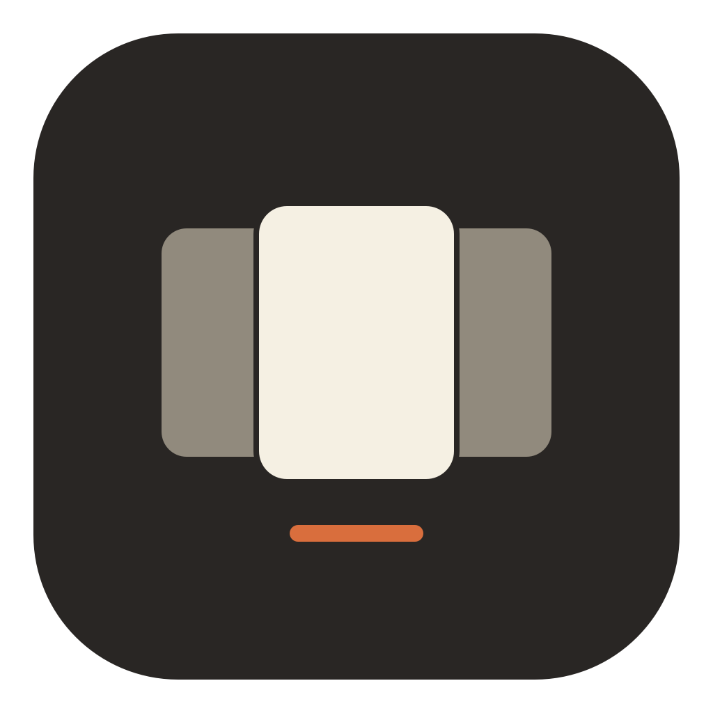
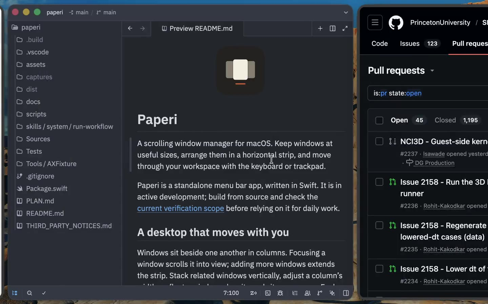
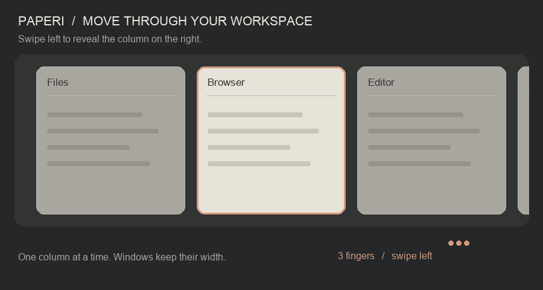
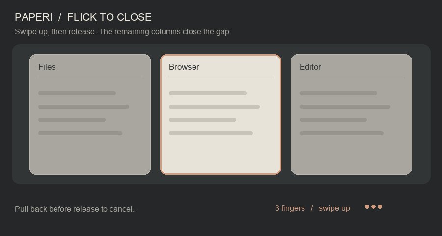
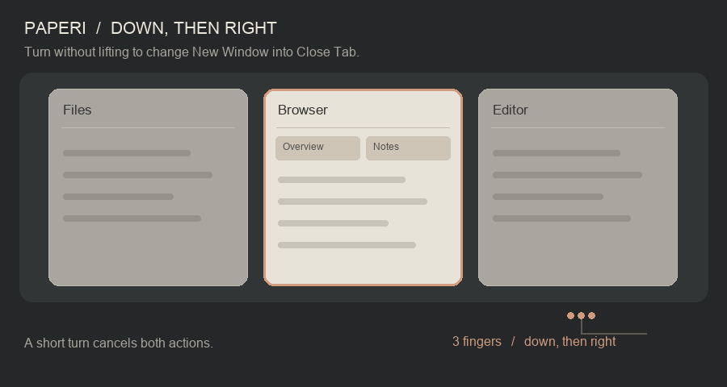
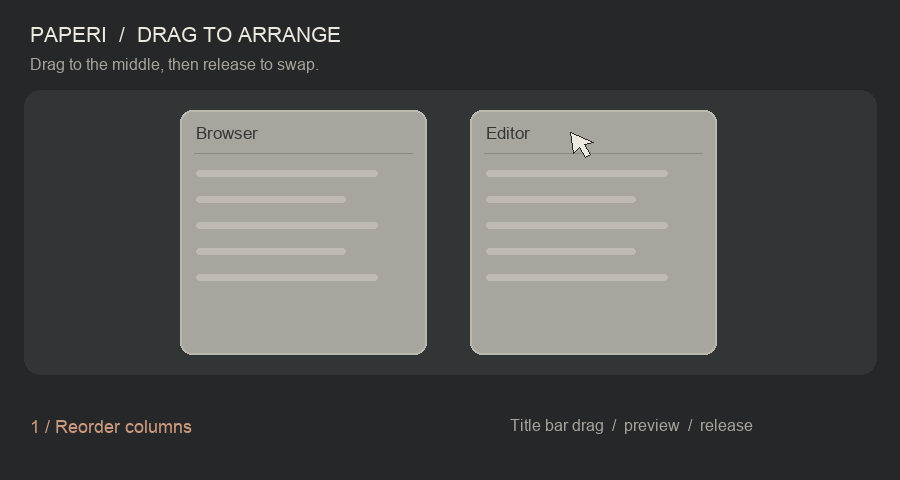

<p align="center">
  
</p>

# Paperi

A scrolling window manager for macOS. Keep windows at useful sizes, arrange them in a horizontal strip, and move through your workspace with the keyboard or trackpad.

Paperi is a standalone menu bar app, written in Swift. It is in active development; build from source and check the [current verification scope](docs/STATUS.md) before relying on it for daily work.

## See it in action

[](assets/demos/workspace-demo.mp4)

[Watch the workspace demo](assets/demos/workspace-demo.mp4) — scrolling, window gestures, and drag-to-tile in a real session.

## A desktop that moves with you

Windows sit beside one another in columns. Focusing a window scrolls it into view; adding more windows extends the strip. Stack related windows vertically, adjust a column's width, or float a window when it needs its own space. Each display's active Space has its own strip.



*Illustrated demonstration: focus moves through the strip while windows keep their width. The animations in this README are diagrams, not screen recordings or performance measurements.*

The design draws on [PaperWM](https://github.com/paperwm/PaperWM)'s scrolling layout and [PaperWM.spoon](https://github.com/mogenson/PaperWM.spoon)'s macOS workflow. Palm webOS inspired the card-like motion, flick-to-dismiss interaction, and icon; [Fenrir's Sleipnir browser](https://www.fenrir-inc.com/jp/iphone/apps/sleipnir-mobile/help/iphone.html) inspired the directional gesture vocabulary.

## Install

You need macOS 14 or later and Swift 6 or later through Xcode or Command Line Tools. Validation so far is on macOS 26.7.2, Apple silicon; older versions are not yet verified. Builds are locally signed and are not notarized.

```sh
git clone https://github.com/icui/paperi.git
cd paperi
./scripts/install.sh
```

The script builds a release app, installs it to `~/Applications/Paperi.app`, and launches it. On first launch, grant **Accessibility** access in System Settings. Stop any other tiling manager, including PaperWM in Hammerspoon, before running Paperi.

In **System Settings → Desktop & Dock → Mission Control**, enable **Displays have separate Spaces**. With multiple displays, arrange them vertically in **System Settings → Displays**. Paperi pauses when displays are side by side, because windows scrolling over a shared edge could enter the other display.

Use the menu bar icon to **Pause/Resume**, **Retile**, **Reload Config**, or enable **Start at Login**. **Stop & Restore Windows** stops management and restores the frames saved when windows entered Paperi. To install without launching, use `./scripts/install.sh --no-launch`.

## Trackpad gestures

Use **three fingers** by default (four is configurable). Horizontal swipes move one column at a time. Two-finger scrolling stays available inside apps.

| Finger movement | Action |
| --- | --- |
| Left / right | Move through the strip by one column. |
| Up | Close the focused window; in a native macOS tab group, close its front tab. |
| Down | Open a new window of the focused app. |
| Down, then right without lifting | Close the current tab with ⌘W; this can close a window with no remaining tabs. |

### Flick a window away



The window follows your fingers. Move far enough, or flick, to close it on release. Pull back or release a short swipe to cancel. Native tab groups use a **Close Tab** pill instead of moving the whole window. Apps with their own tab bars, such as Chrome, can use that behavior too: add them to `gesture.tabCloseApps` in the [configuration](docs/CONFIGURATION.md).

### Three configurable downward gestures



Swipe down to **New Window**, down then right for **Close Tab**, or down then left to **Minimize**. Turn without lifting, then continue in that direction and release to commit; a short turn cancels. Configure each with `gesture.swipeDown`, `gesture.swipeDownRight`, and `gesture.swipeDownLeft`: `closeTab`, `newWindow`, `openApp`, `minimize`, or `none`. Downward gestures also work when a popup or the desktop has focus; actions target the frontmost app unless `openApp` selects a specific app, and minimizing requires a window.

New-window creation uses the app's **New Window** menu item, falling back to ⌘N when no matching item is available. To open a window of a specific app, set `gesture.swipeDown` to `openApp` and `gesture.swipeDownApp` to its bundle ID (for example, `com.apple.Terminal`). Paperi launches the app if needed or requests a new window if it is running. You can also change swipe down to minimize, or disable it.

### Window tray

Tap with three fingers to show thumbnails of every window in the strip, centred on the pointer. Click one to focus it, or drag one sideways to reorder the strip. The tray closes on a click outside it, or shortly after the pointer leaves it. ⌥⌘T opens it too. Thumbnails require Screen Recording permission.

If macOS uses the same finger count for Mission Control, Spaces, or three-finger drag, Paperi disables its conflicting swipe and shows a warning. Change the system gesture or set `gesture.fingers` to `4`.

## Drag to reorder or tile vertically



*Illustrated demonstration: drag by the title bar, choose a highlighted drop zone, then release.*

Drag a window by its title bar over a neighboring column or another window in its own stack. Dashed guides show the drop zones, and a labeled preview shows where it will land. Release over the preview to apply it.

| Drop location | Result |
| --- | --- |
| Middle of a window in a neighboring column | Swap their positions to reorder the strip. |
| Top quarter of a window in a neighboring column | Tile the dragged window above it in the same column. |
| Bottom quarter of a window in a neighboring column | Tile the dragged window below it in the same column. |
| Middle of another window in the same stack | Swap their vertical order. |
| Left / right quarter of another window in the same stack | Move the dragged window out into its own column on that side. |

For example, drag an editor onto the bottom zone of a browser window to tile the browser above the editor. They share a column and scroll together. To return the editor to a separate column, drag it onto the left or right zone of the browser.

Move windows between Spaces and displays with Mission Control; Paperi follows their destination.

## Keyboard shortcuts

All default shortcuts below use **⌥⌘ (Option–Command)**.

| Keys | Action |
| --- | --- |
| J / K | Focus the column to the left / right. |
| ← / → / ↑ / ↓ | Swap columns or stacked windows. |
| H / L | Make the column narrower / wider. |
| U / N | Make a stacked window taller / shorter. |
| C | Center the focused column. |
| S | Split the available width with the left neighbor. |
| I / O | Stack into the left column / move out into a separate column. |
| F | Toggle floating for the focused window. |
| T | Show the window tray at the pointer. |

Dialogs, sheets, menus, and popovers stay outside the strip. Utility windows without a fullscreen button float by default. Native macOS tab groups share one position in the layout.

## Make it yours

Choose **Open Config…** from the menu bar. Settings live in `~/Library/Application Support/Paperi/config.json`; omitted settings keep their defaults. For example:

```json
{
  "gap": 10,
  "exclude": ["us.zoom.xos"],
  "gesture": {
    "fingers": 3,
    "swipeDown": "newWindow",
    "swipeDownRight": "closeTab",
    "swipeDownLeft": "minimize",
    "tabCloseApps": ["com.google.Chrome"]
  }
}
```

Choose **Reload Config** after saving. See the [configuration guide](docs/CONFIGURATION.md) for window rules, shortcut customization, gesture sensitivity, and command-line control.

## Troubleshooting

- **Windows are not moving:** check Accessibility access and the menu bar status. If an old permission entry no longer works, run `tccutil reset Accessibility dev.paperi.app`, relaunch, and grant access again.
- **Shortcuts do nothing:** another app may own the same shortcut. Stop the other manager or customize Paperi's bindings.
- **Paperi pauses:** check the menu's explanation, separate Spaces, and display arrangement.
- **Gestures also scroll an app, or scrolling breaks after a macOS update:** disable Paperi gestures with `"gesture": {"enabled": false}` and reload, or quit Paperi.
- **Recover after a crash:** run `~/Applications/Paperi.app/Contents/MacOS/Paperi restore` to restore window frames from the saved journal.

Paperi uses private macOS interfaces for Space information and trackpad gesture handling; OS updates can break these features. Read the [compatibility notes](docs/MACOS-COMPATIBILITY.md) for limitations and recovery details.

## Development and credits

```sh
./scripts/swift.sh build
./scripts/swift.sh test
```

There are no third-party Swift package dependencies. See [development and diagnostic notes](docs/DEVELOPMENT.md), [implementation status](docs/STATUS.md), and the [archived design plan](docs/archive/PLAN.md).

Thanks to [PaperWM](https://github.com/paperwm/PaperWM), [PaperWM.spoon](https://github.com/mogenson/PaperWM.spoon), [Hammerspoon](https://github.com/Hammerspoon/hammerspoon), and [yabai](https://github.com/asmvik/yabai) for the scrolling-window workflow and implementation references. The [reference audit](docs/REFERENCE-AUDIT.md) records which mechanisms were studied. The Mission Control test helper adapts code from PaperWM.spoon; its copyright and MIT license are preserved in [third-party notices](THIRD_PARTY_NOTICES.md).

Palm webOS and Fenrir's Sleipnir are design inspirations. Paperi's icon and demonstration artwork are original; no Palm or Fenrir artwork or code is bundled. Paperi is an independent project, with no affiliation implied.
